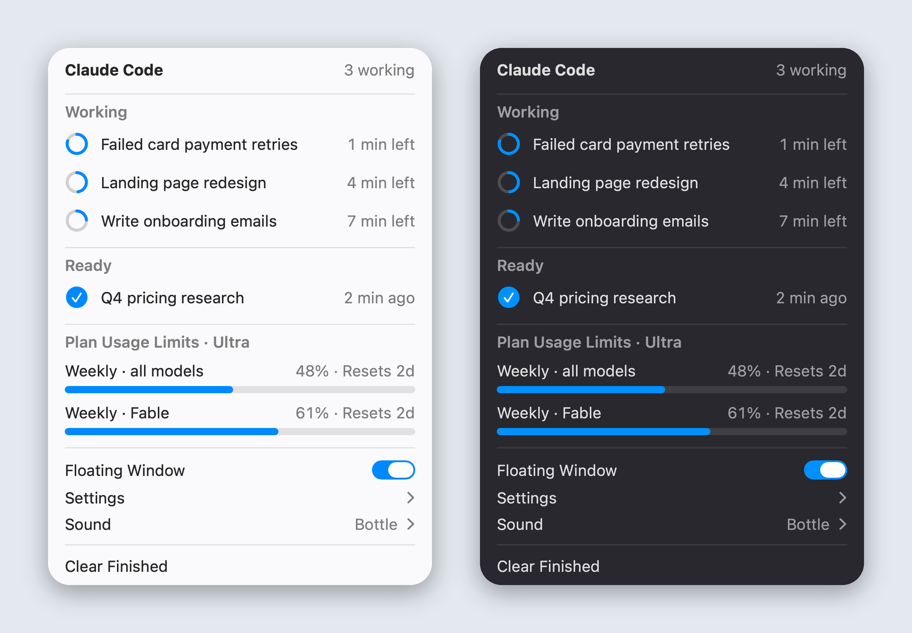

# Pulse for Claude Code

A small macOS menu bar app that shows what every Claude Code chat is doing: which chats are working, how many minutes each one has left, which one needs you, and which reply is ready.

Made by [WeTrio](https://wetr.io). Not affiliated with Anthropic.



## What it does

- **Menu bar icon.** A ring with the time left on the nearest reply, a check when a reply is ready, a "!" when a chat needs your answer. The icon shows only while something is going on.
- **Panel.** Click the icon: one line per chat with its status and time. Click a chat to open it in VS Code.
- **Floating window.** Switch from VS Code to another app and a small window stays in the corner with the same status. Hover it to close it; drag it anywhere. Turn it on or off in the panel.
- **Sound.** One soft sound when a reply is ready or a chat needs you. No notifications or banners.
- **Plan usage limits.** Weekly limits under the chats, the same numbers Claude Code shows.
- **Light and dark**, following macOS.


The time left is an estimate. Pulse learns from how long your past replies took (questions are quick, "do this" tasks take minutes) and updates the estimate while a chat works.

## Install

Requirements: macOS 14 or later (Apple Silicon or Intel) and Claude Code (VS Code extension, terminal, or the Code tab of the Claude app). Plain claude.ai chats are not tracked.

1. Download `Pulse-for-Claude-Code.zip` from [Releases](../../releases/latest) and unzip it.
2. In Terminal:

   ```sh
   zsh ~/Downloads/Pulse-for-Claude-Code/Install.command
   ```

The icon appears as soon as a Claude Code chat starts working. Chats that are already open are picked up too. To update, run the same command with a newer download: settings and history stay.

The app is ad-hoc signed, not notarized. Installing from Terminal clears the download quarantine, so macOS does not block it.

## What it changes on your Mac

- The app goes to `~/Applications/Pulse for Claude Code.app`.
- Hook entries are added to `~/.claude/settings.json` (SessionStart, UserPromptSubmit, PreToolUse, PostToolUse, Notification, Stop, SessionEnd, SubagentStart, SubagentStop). Nothing else in the file changes; a backup is saved next to it first.
- Data lives in `~/.claude-pulse` (events, current state, reply history for the estimate).
- A login item starts the app at login and restarts it after a crash.

## Privacy

Everything stays on your Mac. Pulse makes no network requests, with one opt-in exception: **Live Plan Limits** (off by default, in Settings). When you turn it on, Pulse reads Claude Code's sign-in from your Keychain (read-only, never stored) and asks Anthropic for your current plan limits every few minutes while chats are working. Off, it shows the numbers Claude Code itself last saved.

## Uninstall

```sh
zsh ~/Downloads/Pulse-for-Claude-Code/Uninstall.command
```

Removes the hooks, the login item and the app. Your reply history stays in `~/.claude-pulse`; delete the folder if you want it gone.

## Build from source

Needs only the Command Line Tools (no Xcode).

```sh
./install.sh      # build, install or update, register hooks, start
./build.sh        # build only, into build/
./uninstall.sh    # remove
```

Checks: `build/Pulse\ for\ Claude\ Code.app/Contents/MacOS/ClaudePulse --selftest`.

### How it works

```
Claude Code hook ──> ~/.claude-pulse/bin/pulse-hook ──> ~/.claude-pulse/events/*.json ──> the app
```

| File | What |
|---|---|
| `Sources/Hook/main.swift` | the hook: writes one small event file per Claude Code event |
| `Sources/App/Store.swift` | chat state machine and event intake |
| `Sources/App/Estimator.swift` | time-left estimate from past replies |
| `Sources/App/PanelView.swift` | the panel (SwiftUI) |
| `Sources/App/MiniWindow.swift` | the floating window |
| `Sources/App/StatusIcon.swift` | menu bar icon and text |
| `Sources/App/Usage.swift` | plan usage limits |
| `Sources/App/App.swift` | app delegate, windows, sounds, opening a chat |
| `Sources/App/Setup.swift` | hook registration and history seeding at install |
| `scripts/install-prebuilt.sh` | the installer (`Install.command` in the release) |
| `scripts/package.sh` | builds the release zip |

## License

MIT. See [LICENSE](LICENSE).
